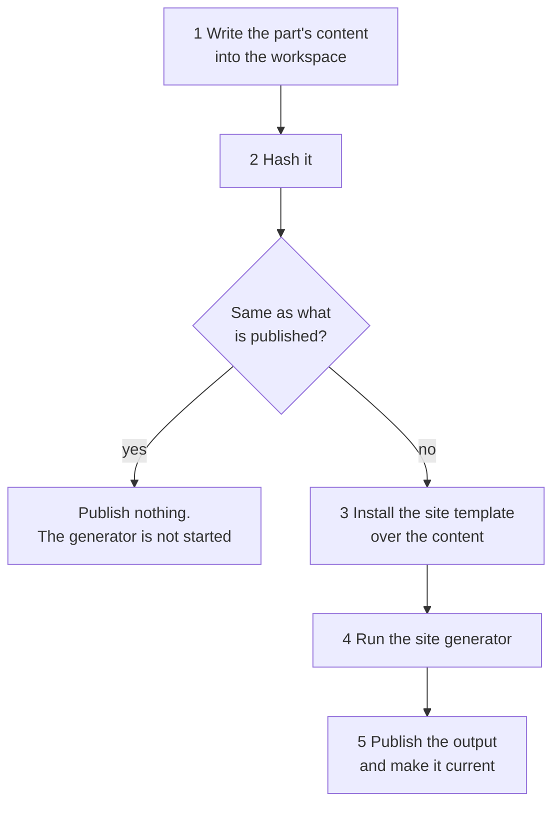

# Generating the documentation

The doc service does not only receive documentation, it publishes it: it runs the site generator over what it
knows, puts the result into the object storage and serves it. This page is about that half - what a build does,
what makes one happen, and what to look at when one does not.

## What a build is

A **documentation site** is one published whole: one navigation and one layout. Which sites exist is
[configuration](configuration.md#documentation-sites); each of them has its own **environments** - trees of the
same documentation showing the state of a different stage.

A site configured with `per-environment: false` has no environments: it is **one tree**, served at the site root.
The generator writes it to `content/tree` rather than to one directory per environment, and the site template
mounts it at the root - with no environment switcher, no banner and no environment in a search. Its only part is
the shell.

**What a part contains is its site's content source's.** The documentation of the systems is what is described
below; a static site is its uploaded tree, written as it is, with a generated root page only where the tree brings
none - see [Configuration](configuration.md#where-a-sites-content-comes-from). Around either, the generator writes
the same site-level files: the page about the documentation, the branding, and what the site template reads.

**A site is not one build any more.** It is published as several, one per **part**, because one build of a whole
landscape stopped fitting: the memory a build needs grows with the pages it produces, and a site of eighteen
thousand pages needs more of it than any container is given. So the site is cut up, and the doc service serves
the pieces as one site.

| | |
|---|---|
| A **part** | What is generated, published and served as a unit: a set of whole URL subtrees of the site |
| The **shell** part | The site's own pages - the root page of each environment, the systems index, the page about the documentation - and whatever no other part claims |
| A **system** part | One system, in every environment of the site: `/systems/orders/`, `/dev/systems/orders/`, and so on |

A part is a whole URL subtree and not an arbitrary set of pages, and that is not a preference: a Docusaurus
build puts everything it emits under its own base URL, so a request has to resolve to exactly one part. The
files every part emits identically - the bundles under `assets/` and the site's own images under `img/` - are
published once for the whole site and served from there.

One run of the generator is a **build of one part**, and it is five steps:



**The hash is what makes a part per system affordable.** Writing a part's content is a fraction of a second and
generating its site is minutes, so the cheap half decides whether the expensive half runs at all. What is
hashed is the content itself - not the model it came from - so whatever a page is made of is covered: the
architecture model, a replicated artifact, an uploaded document, a generator that writes something differently,
a new version of the doc service. What is taken out of the hash first is the build identifier and the timestamps
of generation, architecture import and reaction import, or two runs over documentation nobody changed would differ.
An environment-wide reaction import can advance because another system changed. That timestamp alone does not
rebuild an unchanged system part. The shell still hashes the complete reaction graph file, so changed graph
data is published.

These values are **provenance**: they say *this content is as of then*, which stays true for a part that is not
built again. Nothing else about a run is written into a page. Anything that would go stale in a page nobody
rebuilds - when the architecture repository was last read, whether the import is behind, when the schedule
fires next - is not generated at all but answered live, and fetched by the page that shows it. That is the rule
to follow when adding something a page says about the service: **provenance goes in the page's front matter
and into the volatile set; status is served beside the site.** The front matter is where it goes because the
site template renders it from there, the same way for a page the service generated and for one a team
uploaded - and nothing rewrites an uploaded page's body, so nothing can be added to it. Hiding a status value
from the hash instead would freeze the page that is meant to report a broken import, which is the one page
that has to keep working when one breaks.

The order of steps 3 and 4 is not a detail either. **The content is written first and the site template is
copied over it**, and everything at the top level of the workspace that is neither the content nor the
template's own is removed. The application that runs is therefore the template's, byte for byte and at every
depth, whatever was generated into the content directory - which is what will keep documentation uploaded by a
team from being able to become part of the program that builds the site.

### What a part cannot check

Docusaurus checks every link against the routes of **its own** build, and the doc service builds it with
`onBrokenLinks: 'throw'` - which is what catches a generator bug. A link into another part is not one of those
routes, so it is written as `pathname://`, which renders a plain anchor and leaves the check. Inside a part the
check is exactly as strict as it was.

That is why a part per system carries **every environment of its system**: a page that exists on `dev` and not
on `prod` is the shape a generator bug takes, and keeping a system's trees in one build keeps that check.

## What is in a build

Two kinds of documentation end up on one site. A page is one or the other, never both.

|               |                                                                                                                                                                                                       |
|---------------|-------------------------------------------------------------------------------------------------------------------------------------------------------------------------------------------------------|
| **Generated** | Written by the doc service from the architecture model of the environment being built: what the systems are, who owns them, how they are decomposed, what they exchange. Rewritten whole on every run |
| **Custom**    | Written by the team that owns a system, next to its code, and uploaded by its pipeline. The generator never writes those pages and never reads their bodies - it copies them into the chapter their folder names |

A page says which it is. Its front matter carries `doc_status`, `generated` or `custom`, and where the content
came from; the site template renders that under the page, the same way for both. A page that would be half
generated is two pages instead.

**Two models are joined, per system, while a part is built.** The architecture model of the environment says
what the systems are; the documentation a team uploaded says what has been written about them. Nothing links
the two in the database, and a subject can be in either without being in the other:

| The system is in | What is built |
|---|---|
| both | The generated chapters, and the uploaded pages beside them |
| the uploaded documentation only | One page in chapter 1 saying the model does not hold it, and the chapters the team wrote |
| the architecture model only | The generated chapters, and nothing else |

The second of those is why a part exists for a system nothing has deployed: the site partition takes the union
of the two, or nothing would ask for that part to be built. See
[The documentation a team writes](custom-documentation.md).

### The structure template

Where a page is served follows from the **structure template** the documentation is organised by. The doc
service ships [arc42](https://arc42.org). A further structure template is a further module - see
[Structure templates](structure-templates.md) for what a template is and how to add one. The layout below is
what arc42 produces:

```text
/systems/                                                              every system, with its team
/systems/orders/                                                          what the system is, and its structures
/systems/orders/system-architecture/                                      arc42 for the system
/systems/orders/system-architecture/intro/                                1. Introduction and Goals
/systems/orders/system-architecture/context-and-scope/                    3. Context and Scope
/systems/orders/system-architecture/context-and-scope/system-context-view/
/systems/orders/system-architecture/building-block-view/                  5. Building Block View
/systems/orders/system-architecture/building-block-view/whitebox-view/
/systems/orders/system-architecture/building-block-view/components/orders-foo-bar-service/
/systems/orders/system-architecture/building-block-view/events/orders-payment-accepted-event/
/systems/orders/system-architecture/building-block-view/commands/orders-check-availability-command/
/systems/orders/system-architecture/runtime-view/                         6. Runtime View
/systems/orders/system-architecture/runtime-view/system-reactions/        what was observed reacting
```

**A component carries the same structure one level down**, below its own page and under a segment named for
what it describes there:

```text
.../components/orders-foo-bar-service/                                    the component, in the system's tree
.../components/orders-foo-bar-service/component-architecture/             arc42 for the component
.../component-architecture/intro/                                         1. Introduction and Goals
.../component-architecture/context-and-scope/                             3. Context and Scope
.../component-architecture/context-and-scope/context-view/                the component context view
.../component-architecture/building-block-view/                           5. Building Block View
.../component-architecture/building-block-view/database-schema/           the entity relationship diagram
.../component-architecture/building-block-view/rest-api/                  the API by group, and the Swagger link
.../component-architecture/building-block-view/messages/                  what it produces and consumes
.../component-architecture/runtime-view/                                  6. Runtime View
.../component-architecture/runtime-view/component-reactions/              what was observed reacting
```

Four rules follow, and an upload has to keep the first three too:

- **The chapter folder carries its arc42 number, the URL does not.** A chapter is the folder
  `5-building-block-view`, is served at `/building-block-view/`, and reads as *5. Building Block View* in the
  navigation. Links then survive a renumbering. A relative Markdown link between two pages of a repository
  still resolves once they are published.
- **A chapter with nothing in it does not exist.** The generator creates the four it has something to say
  about. A gap in the numbering means a chapter has not been written, not that it is empty.
- **A component lives inside the building block view.** A component is one of the blocks, so its documentation
  sits where the decomposition is described, next to the events and commands that flow between them. Its own
  chapters hang below its page, and the page links to them.
- **A message is documented under its name, kebab-cased.** `OrdersPaymentAcceptedEvent` is served at
  `.../events/orders-payment-accepted-event/`. Every message of the model gets its page: the segment is derived
  and checked by [the import](architecture-import.md#every-name-becomes-a-slug), which refuses a name that
  yields none, one that would be the listing of its group, and two that yield the same - so no page can be
  written over another. The building block view links to a group of messages only when the system defines
  one of that kind.

### The diagrams

A diagram is **fenced source, never an image**: the page carries the PlantUML and the site's plugin renders it
in the reader's browser, so a diagram stays searchable, diffable and readable as text. Nothing generates a
`.png` or an `.svg`.

Four pages carry one:

- **The system context view**, in *3. Context and Scope*, draws the system in the middle and every other system
  it exchanges something with around it. It is laid out **left to right**, because a star of two ranks is a
  narrow column that way and a wide ribbon the other way.
- **The level-1 whitebox view**, in *5. Building Block View*, carries at most **two** pictures of the same
  system: *Inside the system* - its components and what flows between them, and nothing else - and then one
  picture of what it exchanges outside. That second one is *With the neighbouring systems*, which adds every
  other system as a single box, or, where that is too large, *Across the system boundary*: only the components
  that exchange something outside, the neighbours, and the arrows between them. See
  [How much a whitebox picture draws](#how-much-a-whitebox-picture-draws).

- **The component context view**, in a component's own *3. Context and Scope*, draws that component in the
  middle of its system's package and, beside it, **every counterpart it exchanges something with as its own
  box** - the siblings inside its own system's package, the components of other systems inside a package for
  the system that owns each. Only the counterparts it exchanges something with: drawing all of a system's
  components would make the page that system's whitebox view. **A package is not a decomposition**, and the
  page says so: it holds the counterparts, never everything the neighbour has.

  A neighbouring system is **one box** in two cases - the architecture model names no counterpart component
  for it, or the bound on the boxes left no room to open it. An arrow then lands on that box, and two
  relations to different components of that system are one arrow carrying both sets of labels. Where the model
  names a component but not the system that owns it, the diagram has no box for it at all - a box outside
  every system would read as a component of no system - and the page names those separately, because their
  relations are on its table with nothing in the picture.

  Every box links to its own page, and so does every package: opening a neighbour must not cost the reader the
  way into that neighbour's own documentation. It is laid out **left to right**, because its shape is the
  context view's.
- **The entity relationship diagram**, in a component's *5. Building Block View*, draws an entity per table of
  the database schema its build published - the primary key columns above a separator, `*` for a column that
  cannot be null, `<<PK>>` and `<<FK>>` markers, and one arrow per foreign key.

**A component can be left out of the views.** One that matches
[`view-excluded-components`](configuration.md#the-architecture-model) is not drawn on the system context view,
the whitebox view or another component's context view, and no relations table there lists it. It keeps its own
pages, which say so, and its own context view shows what it exchanges.

**And so can a single relation.** An entry of
[`view-excluded-relations`](configuration.md#the-architecture-model) names a consumer, a provider, a method, a
path or a message type - all the fields it gives have to match - and that relation is drawn nowhere and listed
in no relations table. **It removes arrows and never boxes**: the components keep their boxes on every picture,
including the whitebox view of their own system, so the worst a wrong entry can do is hide a relation. The
component an entry names says on its own page that some of its relations are left out elsewhere.

It is for the traffic that is the platform's own plumbing rather than a component's architecture. Every
component uploads its database schema and its OpenAPI specification to the architecture repository, which put
the architecture repository on 37 context diagrams as a neighbour reached by nothing else - one true thing, said
37 times, in the place a reader goes to find out what a system talks to. Leaving the *component* out instead
would take the nine edges that are architecture with it.

A system left with no relation at all then gets no context chapter, by the same *no content, no page* rule as
everywhere else.

**Neither of the two reaches a counterpart column.** The **Callers** of an operation and the **Consumers** and
**Publishers** of a message are read from the relations and the contracts rather than from a view, so a
relation that is not drawn is still named where a reader asks who does this.

The whitebox page draws *Inside the system* only when the components of the system actually exchange something,
and the second picture only when something crosses the boundary. Otherwise the two would be the same boxes
twice. A system or a component that exchanges nothing gets
no context chapter at all, and a system with no component no whitebox page - see
[No content, no page](structure-templates.md#arc42).

**An arrow is labelled with what travels along it, up to a limit.** Above
[`max-edge-labels`](configuration.md#the-architecture-model) names, the arrow shows the count for its kind
instead - `5 Events`, `6 Commands`, `3 REST Calls` - and the page says so in a note. The names are never lost:
the **Relations** table of the whitebox page and the **Neighbours** table of the context view list every
relation with everything travelling along it, each linked to its message page where the system defines the
message.

The cap is not a matter of taste. The diagram engine lays a label out by recursion and overflows the browser's
stack at about sixty lines, and a diagram that fails to render is an error box on the page that fails no build -
so an arrow of a busy system has to be summarized for the diagram to exist at all.

### How much a whitebox picture draws

**A whitebox view is the one view whose arrows grow with the square of its boxes**: it is where components talk
to components. A context view is a star - one subject with its counterparts around it - so its arrows grow with
its boxes, and an entity relationship diagram and a reaction graph are bounded already. Twenty-five components
with 188 relations between them is a mat of lines with nothing for the eye to follow, whatever the engine, and
no subset of it is both readable and honest.

So a whitebox picture is drawn in one of three ways, by how many relations it would carry:

| Relations                                                          | How it is drawn                                                                                                                                                                                                  |
|--------------------------------------------------------------------|-------------------------------------------------------------------------------------------------------------------------------------------------------------------------------------------------------------------|
| up to [`max-detailed-edges`](configuration.md#the-architecture-model) | In full: an arrow per kind and direction, in its colour, carrying the names                                                                                                                                       |
| up to [`max-diagram-edges`](configuration.md#the-architecture-model)  | **Folded to its shape**: one grey line per pair of boxes, whatever travels between them - no kind, no colour, no name. A line keeps its arrowhead where the pair is joined one way, and loses it where both do  |
| above that                                                           | **Not drawn at all.** The page says so in a sentence naming how many relations there were                                                                                                                         |

Between the two sits the picture whose *shape* is worth seeing - which components are hubs, which corner of the
system is dense - while the names are what make it unreadable. A folded picture says underneath it how many
relations went into how many lines, because a grey line and a missing arrowhead are not self-explanatory.

**The page shows at most two pictures**: the decomposition where it is within the bounds, and then one picture
of the outside - the whole one where it fits, and the boundary one where it does not. Where neither can be
drawn the page is the tables, which carry every component and every relation whatever the pictures did.

**Every architecture diagram is laid out left to right**, and the spacing is about the engine's own defaults.
Tighter spacing takes several times the area off the largest diagram and costs the reader the gaps the arrows
are routed through, which was measured and was the wrong criterion.

### What the colours mean

The box of the **subject** - the current system on a system context view, the current component on a component
context view - is **gold** and outlined bold. A **relation** is drawn the way the architecture repository's
Confluence pages drew it:

| Relation | Arrow            |
|----------|------------------|
| Event    | dashed, green    |
| Command  | dashed, blue     |
| REST     | solid, blue      |

A message and a REST call differ by the line as well as the colour, so no meaning rests on colour alone. The
entity relationship diagram keeps its black crow's feet, which are data-model notation rather than relations.

**The colours are the same in either colour mode**, and that is a decision rather than an oversight. The site's
diagram plugin re-renders a diagram with the engine's dark palette when a reader switches, which moves
PlantUML's *own* fills and strokes - but never a colour written into the diagram's source. These two are
written into the source, because the subject is the subject and a relation is a relation in either mode.

The same holds for the boxes: above [`max-diagram-nodes`](configuration.md#the-architecture-model) other
systems, a diagram leaves the rest out and says how many. A system's own components are never left out of the
whitebox view - every one of them has a page, and one missing from it would be a page no diagram points at.

A component's context view is bounded the same way, by
[`max-context-components`](configuration.md#the-architecture-model) component boxes - its siblings and the
counterpart components of other systems together - and `max-diagram-nodes` other systems. The siblings are
drawn first and then one component of each other system in turn, so one large neighbour cannot push a
component's own siblings off its own page; a system whose components got no box is drawn as a single box, which
is what the whole view was before it named foreign components. And an entity relationship diagram is bounded by
[`max-schema-table-diagram`](configuration.md#the-architecture-model) tables: the tables something has a
foreign key into are kept first, so the arrows of the tables that are drawn still point at a box. A schema of
three hundred tables gives a reader a page that is useful rather than one that fails to render.

These bounds are on the picture and not on the facts. A diagram that had to leave something out says how much,
and the tables below it carry what it left out. **A folded picture is the one bound that changes how a picture
is drawn rather than how much of it there is**, and a dropped whitebox picture is the one that takes the picture
away whole rather than cutting it - a whitebox view is dense rather than long-tailed, so its first hundred
arrows are not a truthful part of it the way a schema's first hundred tables are. The list of tables below an
entity relationship diagram carries what it left out - up to
[`max-schema-table-list`](configuration.md#the-architecture-model) entries. That is a bound on the facts
themselves - with the bound on the entities of a configured group the only one - and [Tables of one name pattern are grouped, and the list is bounded](#tables-of-one-name-pattern-are-grouped-and-the-list-is-bounded)
is what it is for.

### Where the generated content comes from

The doc service **imports** the architecture model of each environment from its
[architecture repository](configuration.md#the-architecture-model), on a schedule of its own, and a build reads
what was imported. A generation run makes no call to the architecture repository at all, so a repository that
is being deployed cannot fail a documentation build - see [the import](architecture-import.md).

What a page shows is therefore the landscape as one import stored it, and every generated page says which
import that was, next to when the page itself was built. **The two are read together, out of one snapshot of the
database**, so a page never names an import its content did not come from - and an import that commits while a
build is reading can neither tear the landscape nor change it under the build. What the build generates from is
the model as it stood when the build started.

Note that the timestamp on a page is not the same thing as the staleness warning in the log. The page names the
import its content came from; the warning names how long ago the architecture repository was last read
successfully, which is what says whether the import is still working. A landscape nobody has changed for a
month is not stale - every import in between read it and wrote nothing.

An environment with no architecture repository is a legitimate configuration. Its tree carries the root page and
whatever was uploaded into it, and no build fails over it.

A site may say that it needs the model before it is published, with
`jeap.doc.sites.<site>.architecture-model-required` - the default. Such a site is **not published until its
model has been imported once**: the build is postponed rather than failed, so its request stays standing and
the next poll tries again. The only window this covers is the one between an instance starting and its first
import finishing.

### What a message page shows

A message type gets a page of its own under the building block view of the system that defines it: what it is,
its topic and scope, the contracts on it - and its **versions**, as a table with a row per version.

Where the [message schemas](architecture-import.md#the-message-schemas-looked-at-every-run-fetched-only-when-they-move) have
been replicated, a version's row splits into a sub-row for its key schema and one for its value schema. Each
carries the schema **folded**, then its name linked into the message type registry, and the value row says what
the version is compatible with. Folded, five versions take a screen and the contracts follow right below; the
schema a reader needs is one click away.

The schema is fenced as `java`, which it is not. What is stored is the architecture repository's **rendering** -
every `import idl` inlined, the base types dropped, the namespaces and the enclosing braces removed - and it is
deliberately not valid Avro IDL. There is no language that highlights it correctly, and Java is close enough to
read while being wrong enough that nobody mistakes it for the file; the link beside it is where the file is.

A version whose schemas were never replicated - a new one, or one a run missed at its deadline - keeps its row
in the table, which says so. A replication that is behind never costs a page.

The table is a `grouped-table` directive that `MarkdownWriter.groupedTable` writes and the site template builds
into a table, because a Markdown table can neither span rows nor hold a fold in a cell.

### What a component's pages show

A component already has a page in the tree of its system - its identity card, where a reader finds it in the
decomposition. Below that page it carries its own arc42 tree, with the four chapters the generator writes
into and any its team filled itself. **Which of the generated ones exist depends on what the architecture
repository knows about the component**: 1, 3 and 6 can always be written, and 5 appears when there is a
database schema, a REST API or a message contract to put in it. A component the architecture repository knows
only the name of gets three chapters and no empty folder - and a component it does not know at all gets one
page saying so, with whatever its team wrote beside it.

| Page                        | What it shows                                                                                                                                                                                                              |
|-----------------------------|----------------------------------------------------------------------------------------------------------------------------------------------------------------------------------------------------------------------------|
| *1. Introduction and Goals* | What the component is, its type, the team that owns it with their contact address, the system it belongs to, the importer that knows it and when it was last seen. It repeats the facts of the component's page in the system's tree deliberately: a reader who followed a link into the subtree should not have to go back out for the owner's name |
| *Component Context View*    | The diagram above, and the table of **every** relation with its counterpart, kind and label                                                                                                                                |
| *Database Schema*           | The entity relationship diagram, the database name and schema version, and the list of every table with its columns, their types, whether they may be null and which keys they belong to                                    |
| *REST API*                  | The specification version, where the API is served, the count of operations, the **deep link into the Swagger UI of the architecture repository** - and a table per API group, with each operation's method, path and summary |
| *Messages*                  | What the component produces and what it consumes, with the defining system, the topic and the versions under contract, each message **linked into the tree of the system that defines it** - which is not always the component's own                                                     |
| *Component Reactions*       | Written and empty on purpose: the reactions are observed at runtime and that import is not published yet, so the page says what it is waiting for                                                                          |

**The REST API page is an overview and a link, not a rendered specification.** A rendered specification is a
second Swagger UI, badly, and there is a real one to link to. The groups come from the tags of the replicated
specification; the architecture repository keeps no tag of its own, so a component whose specification has not
been replicated gets its operations from the model instead, ungrouped, and the page says why. **The page is
written either way** - a component with endpoints and no replicated specification is exactly the case a reader
wants to see.

A tag the specification declares and no operation uses is not a group: it would be an empty table promising a
part of the API that is not there. An operation with several tags appears once, under the first.

**A message is documented once**, on the page of the system that defines it. A component's *Messages* page
links to it rather than repeating it.

**And the message need not be its own system's.** A contract is recorded on the message, so a component
consuming another system's event has that contract on nothing of its own system at all - which is the ordinary
case in a landscape that exchanges events. The page therefore resolves contracts across the whole imported
model, names the defining system in a column of its own, and links into that system's tree; where that is
another part of the site the link leaves this build's broken-link check and is rewritten to an absolute URL.
A component whose every contract is on other systems' messages gets the page all the same.

**A contract is matched on the system and the component, not on the component alone.** A component name is
unique within its system and nowhere else - two systems each having a `gateway` is ordinary - so the system is
part of the join. Where the model does not say which system a contract's component belongs to, the name is all
there is and is matched on its own.

**The REST API page describes the component's own operations and not the platform's.**
[`rest-api-excluded-paths`](configuration.md#the-architecture-model) leaves out what matches it, and its
default is the actuator - every jEAP service publishes the operational endpoints the platform needs, and on a
small service they outnumber the operations a reader came for. A group the exclusions empty is gone rather
than a heading over an empty table, the count in the facts row is what the page documents, and one line below
the facts names the operations it left out and why, so that the count can be compared with the specification.
It names twenty and counts the rest. It is no warning: leaving them out is intended. The exclusions apply to the
fallback list from the architecture model too: what a reader is not shown must not depend on whether the
specification has been replicated yet.

**The Database Schema page is written as soon as the model says the component has one**, replicated or not, for
the reason the REST API page is: between an architecture import and the replication of the schema there would
otherwise be no entry in the chapter at all, and no way to tell a schema that has not arrived yet from a
component that keeps no data. Until it arrives the page carries the schema version the model knows and says
that there is no diagram yet and that the next import brings one.

Two tables of a database schema are on neither the diagram nor the list: **`flyway_schema_history` and
`shedlock`**, matched ignoring case, are the machinery of a schema rather than the data of the component. The
page names the ones it left out, because a silently incomplete diagram is worse than one short sentence. The
two names are the jEAP conventions - the Flyway history table of `jeap-spring-boot-db-migration-starter` and
ShedLock's own - and they are matched **by name and not by role**: a component that renamed its Flyway history
table keeps it on the diagram, and one that owns a table of its own called `shedlock` does not get it
documented.

An artifact that cannot be read - bytes that are not JSON, a truncated document - costs its own page and
nothing else. The reason is logged with the component's name, and the page falls back to what the model knows.
There is no `try` around the generation of a site, so a malformed specification that threw would end the
documentation of every system of the environment.

#### Tables of one name pattern are grouped, and the list is bounded

**A partitioned table is documented once.** A component that partitions by day or by tenant publishes a table
per partition: one schema in the estate holds 6583 tables, of which 6321 are partitions of 260. Those are
grouped into one entry per table, named after the shared part of the name with a **`_*` postfix** -
`doc_meta_*` - and each such entry says how many tables it stands for and what their range is. Nothing is
dropped: the facts row keeps both numbers, as `6583 (260 documented entries)`, and a note on the page explains
the postfix.

**The page says what was observed rather than what it means.** The grouping reads a name pattern and compares
columns and primary keys, and a published schema says nothing about what a table is for - so the entry reads
*these tables share this name pattern and this shape*, not *these are partitions of one table*. Tables kept
deliberately apart, one per year or per version, look exactly alike to it, and the count and the range are what
let a reader check.

A family is recognised by two signals, and the second is what makes the first safe:

| signal | what it is |
| ------ | ----------- |
| the stem | the name without its last segment, where that segment looks like a partition key - `_202609`, `_20260904`, `_54`, `_ym110` |
| the column signature | the ordered columns with their types and nullability, and the primary key. Shards of one table are identical, because the database generated them from one definition. The **foreign keys are deliberately not compared**: a hand-sharded child table often carries a reference per shard, and the entry that stands for the family shows the arrows of one shard |

**Two tables of one stem make a family**, so a table partitioned by month is grouped from its second month on.
Two tables kept apart on purpose with identical columns, such as `audit_2024` and `audit_2025`, are grouped too,
and the count and the range on the entry are what tell the reader. A stem whose tables do not all share their
columns and their primary key is left alone entirely. That is deliberate: an `order_v1` beside an `order_v2` whose columns differ are two tables,
and a reader shown one row would never learn it. Nothing here infers what a table is *for* - PostgreSQL knows
the answer properly in `pg_inherits`, and the day the schema publisher passes it on this heuristic goes away.

**An instance can also group tables by configuration.** A component may keep one table per entity and month -
`id_orders_2611`, `id_parties_2611` - so that thousands of tables share one structure under hundreds of names.
The name heuristic above groups each entity's months, but it cannot see that the entities are alike.
[`jeap.doc.generator.schema-table-groups`](configuration.md#the-architecture-model) names such tables per
component with a regular expression. Its named group `entity` says which entity a table belongs to, and its
optional named group `partition` gives each entity its range. A configured group works like this:

- It is applied **first**, and the name heuristic groups whatever is left.
- **The shape is still a prerequisite.** Of the tables a pattern matches, only those with the most common
  columns and primary key are grouped. The matching tables of another shape are documented apart from the group,
  like any other table: on their own, or as one entry where they are partitions of one table. The group's entry
  says how many such tables there are. A single table is never a group.
- A table belongs to the first group of its component that matches it. A match in which `entity` is empty or
  absent is no match.
- The entry is headed by the group's configured name. It shows the shared columns once, then one row per entity
  with its number of tables and their range. The entities are bounded by
  [`max-schema-group-members`](configuration.md#the-architecture-model) (**1000**), and the entry says how many
  it did not list.
- A foreign key into any grouped table points at the group's box on the diagram, and the Key column of the list
  names the group. A key into a partition names its family the same way, also between groups: a partitioned group
  whose tables point at their counterparts in another group draws one arrow between the two. A name the schema
  does not list, such as a partition dropped since, still finds its group or family by its name.
- The entry shows only the foreign keys **every** table of the group declares: the same columns, pointing at
  tables that are documented as the same entry. The entities of a group can point at different tables, so a key
  only some of them declare is left out, and the entry says how many it left out.
- A note says that the grouping is configured, so it is not read as something observed in the names. The pattern
  itself is not on the page.

A changed group takes effect the next time the part of that component's system is built, like every other
setting that is applied when a page is written.

**Grouping happens before either bound applies**, which is what turns both bounds into a formality for all but
two schemas in the estate. Then:

- the **list** writes the first `max-schema-table-list` entries (**200**) by name, with their columns,
- the **diagram** draws `max-schema-table-diagram` of *those* (**100**) by priority - out of the listed
  entries, so a box on the diagram always has a list entry to look it up in, and the diagram is bounded by
  the smaller of the two limits.

Each bound says so on the page, and each says only what it did: the diagram's note counts against the entries
the page **lists**, because the diagram draws out of those - a page whose list is bounded shows fewer boxes
without the diagram's own bound being anywhere near, and the note that named the renderer for that would name
the wrong cause. Where the diagram drew every listed entry there is no diagram note at all, and the list note
carries the rest.

`max-schema-table-list` is a bound on the facts rather than on a picture - with `max-schema-group-members` the
only one - and it is what makes a schema page's cost finite: unbounded, one component's page carried 33 527 rows of columns and cost an hour and a half
to build. Where it applies the page says how many entries it did not write, and it **links nothing**: the only
other place that carries every entry is the architecture repository's own API, which is not a page a reader of
a published site can open. In the measured estate two components' pages are shortened, by about 60 and 54
entries - and after grouping, those entries share a name pattern with tables that are already on the page.

### What the navigation shows

**The sidebar shows the path to the open page.** Only the structure at the top of a system's sidebar starts
open. Every category below it starts closed, Docusaurus opens the ones on the path to the page the reader is on,
and opening a category closes its siblings (`autoCollapseCategories`). The open page has the accent background,
whether it is a page or a category with a page of its own; the categories above it keep only the colour.

**The root page's sidebar lists the systems.** Each of them is built as a part of its own, so their pages are
in no tree the shell's build can see: the generator names them in `environments.json` and the site template
hangs one link per system under the systems index. The category is found by a custom property in its
`_category_.json` rather than by its label.

**A link into another part stays in the reader's tab.** Such a link is rewritten to `pathname://` so that it
escapes the build's broken-link check, and Docusaurus reads any protocol as "not this site" - which made every
one of them open a new tab. The template passes `target="_self"` for those hrefs, in
`src/theme/MDXComponents/A` for a Markdown link, in `src/theme/DocSidebarItem/Link` for a part's way out, and
in the configuration for the footer and the navbar logo. Links inside a diagram were never affected: they are
written absolute and rendered by PlantUML, which navigates the top-level context.

**An instance of several sites links them in the header bar.** The generator writes the instance's title and
one tab per site - label, URL, whether it is the current one - into `site.json`, and the template renders the
tabs left in the bar as plain links: every site is its own Docusaurus build, so a tab is not a route of the build
it sits in. The generator writes them only for an instance with more than one site or a configured title, so a
single site keeps the content it hashed to. On an instance of several sites, a change to the sites changes the
content of every part once, and each part takes it with its next build - see
[Configuration](configuration.md#several-sites-in-one-header-bar).

### Every table can be sorted, and a long one filtered

**A reader sorts any table by a click on its header**: ascending, descending, then back to the order the page
wrote. A column of numbers alone - `12'408`, `987`, `1.10` - is right-aligned and compared by value, so `987`
comes before `2'150` and `1.9` before `1.10`. **A table of more than 15 rows also gets a filter** above it: a row
stays when it contains every word typed, the matches are marked, and the bar counts the rows left. Escape
or the clear button shows every row again.

It is `src/clientModules/tableControls.js` in the site template, and it applies to generated and uploaded pages
alike - nothing on a page asks for it. It moves the rows and cells a table already has and builds no cell from
text, so links, code and escaping stay as they were. **A table with a merged cell is left alone**, such as the
versions of a message page: sorting its rows one by one would tear a sub-row from its version.

### Who is on the other side, on a component's pages

A component's **REST API** page names, per operation, the components known to call it - the **Callers**
column - and its **Messages** page names the **Consumers** of what it produces and the **Publishers** of what
it consumes. Both were on the architecture repository's Confluence pages and are what a reader asked back.

| Column                   | Read from                                                                            |
|--------------------------|--------------------------------------------------------------------------------------|
| `Callers`                | the REST relations of the landscape whose provider is this component                 |
| `Consumers`, `Publishers` | the contracts of the message itself, so this page and the message's page agree       |

**A caller is joined to an operation by its method and its path.** The operation comes from the replicated
OpenAPI specification while the relation carries the path of the architecture repository's `RestApi`, and the
two spell one path differently. The path is normalised the way the architecture repository normalises it
itself - `RestApi.pathWithoutVariableNames`, which is how its own importers resolve an observed call onto an
operation: every path variable becomes `{}`, so `{bpId}` and `{businessPartnerId}` are one segment, and one
trailing slash is removed unless the path is `/` itself. The method is compared ignoring case, because here
the two sides come from two different parsers.

**A called operation the specification does not declare keeps its callers.** The model holds concrete paths -
a `GET /api/vats/1` against a specification with no `/api/vats` in it - that no normalisation joins onto a
row. They are named under the tables, with their callers, rather than dropped.

**A Pact contract rides with the caller that has one**, as a small `pact` link raised above the line after the
name - it is on the relation, and the doc service has imported it all along without showing it. The page
writes a `:sup[…]` directive rather than a `<sup>` element, which `remark-superscript` in the site template
turns into one: raw HTML in a page is escaped and shown as text. A counterpart is a link where this
run wrote the component's page and plain code where it did not, and an operation or a message with no
counterpart gets `-`.

**A list inside a table cell is a `:list[:item[…]]` directive**, which `remark-cell-list` in the site template
turns into `ul` and `li` - a Markdown list cannot stand in a cell, and raw HTML is escaped. The governance pages
use it for the further lines of a rule's result.

**The view exclusions do not reach these columns.** `view-excluded-components` and `view-excluded-relations`
bound the views and the relations tables written from them; a counterpart is read from the relations and the
contracts themselves, so an excluded component is named here like any other - `POST /api/dbschemas` keeps all
its callers on the page of the component that offers it.

The cell holds every counterpart, comma separated. **The site template shows the first three and puts the rest
behind a `+N more` chip** the reader opens - `tableControls.js` again, the module that sorts and filters, so
the page itself is complete for the filter and for the search index. Filtering for a name the chip hides opens
that cell, and clearing the filter closes it again.

### The page that describes the documentation

Every environment tree, and the one tree of a site without environments, carries an **About This
Documentation** page, at `/about-this-documentation/`, linked
from the root page and from the footer. It answers what a reader of a published site cannot otherwise find out:
what they are looking at, where it came from, and when it changes next.

| Section                         | What it says                                                                                                                                             | Where it comes from                                   |
|---------------------------------|----------------------------------------------------------------------------------------------------------------------------------------------------------|-------------------------------------------------------|
| Overview                        | The site, the tree, the structure templates this instance generates, whether an upload publishes the site, whether it waits for the architecture model   | The configuration, through `DocumentationProvenance`  |
| The publication you are reading | Which build produced this site and when - and the numbers of that run, fetched                                                                           | The build itself, and `about-this-documentation.json` |
| The environments of this site   | Per environment: which tree it is, what its model contributed, when that content was imported. Left out on a site without environments                   | The run                                               |
| Scheduling                      | A row per scheduled job of the service - the import that publishes the site, the reconcile, and the three clean-ups - and, fetched, when each fires next | The configuration, and `live-status.json`             |

**One page per tree rather than one per site**, which is forced rather than chosen: the site template switches
Docusaurus' pages plugin off, so a page outside the environment trees cannot be served - and a single page in
the main tree would be linked from the others as `/about-this-documentation/`, which the environment-links
plugin prefixes with the reader's tree, giving a route nothing wrote and a build that fails on a broken link.

#### The numbers of the run, and why they are fetched

A page cannot describe the build that writes it. The pages, the bytes and the duration are known when the
generator has finished; the page was written at the start of the same run. Printing the previous
publication's numbers instead would print numbers that are not the reader's.

So the run writes them **at the seam** - after the generator, before the upload, while the site is still on
local disk:

```text
generate()                                 the content, the template, Docusaurus
  └─ pageCount, sizeInBytes, generatorMillis         ◀ the numbers exist here
describeRun(...)  ──▶  about-this-documentation.json  ◀ written into the output
publish(prefix, directory)                            the upload
```

The page links that file absolutely and a client module of the site template fetches it, takes **only its
path** so the request is same-origin whatever `jeap.doc.publication.url` says, and fills a table in after the
heading. Everything about it degrades quietly: a reader with no scripts, an older publication without the file
and a fetch that fails all get the page as written, which is why the sentence under that heading names the file
rather than relying on the table appearing.

#### What is true only now, and why it is fetched too

The same problem one step further along. A part whose documentation has not moved is not generated again - that
is what the content hash is for - so its pages keep the words the last build wrote. For provenance that is the
truthful reading. For **status** it is a lie that nobody can correct, and the sharpest case is the one that
matters most: an import that stops running would leave the page claiming *last read 09:45* for as long as
nobody changed a document, because the page that would report the failure is the page that stopped being
rebuilt.

So the `Next` cell of every row of the schedule table is not written into the page at all, and is fetched.

`GET <base URL of the site>live-status.json` answers the whole site in one request - every schedule the page
tabulates, and every environment's last read for whoever reads the resource itself. It is a path of the site
and is therefore served to anyone who can read the site, exactly as the page is; the administration API below
`/api` is a different resource with a different rule, and what may be published is decided in
`DocumentationProvenance` for both. It is answered `no-store`: a cached copy would be the frozen page again
with an extra step.

The page keeps its cells and links the resource under the table as its source. The client module finds the
resource through that link, uses only its path, and inserts nothing when the fetch fails - the same three
choices as the numbers of the run above.

### Search is the last step of a pass

A pass ends by indexing the sites it published a part of - one index over the whole site, built from the same
content the parts are written from, once per publication whatever the number of parts and whichever instance
published them. There is no schedule: a site is indexed when it changes. Indexing runs after the parts are
published and **cannot fail a publication**: a site whose index could not be built goes on being searched with
the index it had before.

**[Searching the documentation](search.md)** is the whole of it - what is indexed, what a reader gets, where an
index lives and how one is cleaned up.

### And there is no sitemap

For the same reason, one step further along. The sitemap plugin writes `sitemap.xml` at the root of the build
that ran, so a site published as several builds emitted one sitemap per part - and only the shell's is at a
path anything requests, naming the environment root pages, the systems index and the about pages, and none of
the documentation. A sitemap that claims to be the site's and lists none of its content is worse than none.

What would be right is a **sitemap index** the shell writes from what the other parts emitted. That is the
doc service's to write rather than the generator's, like the search, and it is not worth the machinery for a
crawler hint on documentation nobody crawls.

### The runtime views

Chapter 6 is written from what actually happened rather than from what the model says: the reaction graphs the
[reaction observer](architecture-import.md) of that environment saw, imported beside the architecture model.

| Where                                             | What it draws                                                                                                  |
|---------------------------------------------------|----------------------------------------------------------------------------------------------------------------|
| A system's `runtime-view/system-reactions/`       | Which message makes one of the system's components react, and what it publishes in answer                      |
| A component's `runtime-view/component-reactions/` | The same for one component, linked from its group menu on other pages |
| A message's own page, in chapter 5                | A `## Reactions` section: what was observed reacting to that message, one diagram per variant                  |

**No reactions, no chapter.** A system, component or message nothing has been observed reacting to gets no
page at all, and the landing page does not link one - an empty page would say *this system does not react*,
which is not what an absence means. It is also the normal state of a platform whose reaction observer has just
been switched on.

**The diagram is the browser reaction viewer**, deriving its selection from the complete environment
snapshot. The old generated DOT diagram is no longer emitted. Group and interface context menus link to
component and message documentation; targeting a particular node or variant through a deep link is not yet
supported by this viewer.

`FULL_REACTIONS` supplies chapter availability, message variants, reaction tables, documentation links and
the viewer. Each service instance holds the parsed snapshot per environment, keyed on the stored graph's
import timestamp, checked through a projection without graph bytes. Parallel parts share the snapshot
and documentation index. A graph replacement reloads the bytes; an architecture model change rebuilds
ownership and documentation links. An unchanged graph confirmation does not reload the bytes.
The browser snapshot hash covers content and ownership, excluding the import timestamp. An identical
graph imported again therefore leaves the shell and unpartitioned-site content digests unchanged,
while graph or ownership changes still invalidate them. The JSON retains the import timestamp as provenance.
Within a part the same snapshot supplies its JSON and pages. Component ownership includes the system, so equally named components in different systems stay
separate. Unknown ownership is retained in message views without inventing component destinations. The
three subject import kinds and their indexes are retired.

**And a table sits under every graph** with one row per reaction - what triggered it, which component reacted,
what it published in answer and how often it was seen. Its text is searchable with the browser's own
find-in-page. A generated table of the initial selection remains available if the graph cannot be drawn.

The last column is **Median per day**, the reaction's daily median within the observer's statistics window.
Decimal values and zero are preserved; a missing median fails snapshot validation. The live table describes
the individually visible reactions, including HTTP operations and unknown interface types. Superseded
reactions stay in the snapshot and start behind a hidden-content hint. Explicitly revealed reactions also
appear in the live table.
The browser derives live rows from the same JSON and state as the graph, so collapsing or expanding a group
updates its rows too. Filtering and sorting affect only the table and persist across graph changes.

The message pages are the one runtime view that is not in the runtime chapter. A message is a building block
of the system that defines it, so its page is in chapter 5, and a reader who has the message in front of them
should not have to go to chapter 6 to see what answers it. That section names its own source and its own age,
because the page's front matter names the model.

## What makes a build happen

Everything that wants documentation rebuilt asks for a **part** of a site, and none of them builds:

|                             | Which part                                                                                                                                                                                                                                                                                                                                                                                                               |
|-----------------------------|--------------------------------------------------------------------------------------------------------------------------------------------------------------------------------------------------------------------------------------------------------------------------------------------------------------------------------------------------------------------------------------------------------------------------|
| **An upload**               | The part that carries the system the documents are for, and the shell. An upload names a system and no environment at all, and with a part per system it does not have to. The shell holds the systems index, which changes when a system is documented for the first time. A removal asks the same way; once the site no longer has the system, only the shell is asked for. A static site's tree asks for its one part |
| **The architecture import** | **Every part** of every site whose content is the documentation of the systems and that documents the environment it read, when it stored a *changed* landscape - see below. `jeap.doc.build.triggered` is how many parts that was                                                                                                                                                                                       |
| **An operator**             | The part they named, or every part of the site - `POST /api/sites/{site}/builds`, see [API](api.md). It ignores `publish-on-upload`: a site published only when something is uploaded to it is exactly the site somebody has to be able to publish by hand                                                                                                                                                               |

All of them leave the same thing behind: a **request** for that part, at most one at a time. Everything else
follows from that.

A trigger also asks its own instance to look **now** rather than at its next poll, because that instance
already knows there is work - see [the pass](#how-an-instance-builds-a-pass). The other instances find out
when they poll.

**A trigger that asks for every part names a publication**, and every one of those requests carries its
identifier. That is what makes the wall clock of a full publication measurable: its parts are built across the
instances, so no single one of them knows when the last of them finished - see
[Observability](observability.md#the-publication-start-to-finish). An upload names no publication: it asks for
one system, and that is not a publication.

### The import is what publishes a site

There is no publication schedule. The architecture import runs hourly at a quarter to, and when it stored a
landscape it asks for every part of every site documenting that environment - so the sites are published
hourly, from a landscape that is minutes old, on one schedule rather than two that could disagree.

**Which systems of that landscape moved is not asked.** A part is one system, and a part whose content has not
moved is not generated: the build writes the content, hashes it, finds the hash it already published and stops
there. So the price of not knowing is the content of every part - two seconds for a landscape of 19,000 pages,
measured - and never a site rebuilt.

A run that finds the landscape it already had asks for nothing at all: the whole landscape is compared by one
hash before anything is written, and an unchanged one is not even stored. So an hour in which nothing changed
costs one HTTP conversation with the architecture repository and no build.

**A site no import publishes is reconciled on a schedule of its own.** A site whose environments have no
architecture repository behind them is asked for by no import, so its only other triggers are an upload and an
operator - and because the content digest covers the service version, it would keep serving what an earlier
release generated. `jeap.doc.build.reconcile-cron` asks for every part of exactly those sites, every four
hours through the working day by default, and `-` switches it off. It is nearly free: a part whose content has
not moved is not generated. Those builds carry the trigger `SCHEDULE`.

**Only the model step asks for a publication.** The OpenAPI specifications, the database schemas and the
message schemas are replicated by steps of their own, and none of them asks for a build. A component that
publishes a new specification while its architecture model stays the same therefore gets the rewritten page
with the next import that changes the model, or when an operator asks for the part by hand.

The landscape is stored either way: asking for the documentation happens after the import has written it, so a
trigger that fails costs an hour - the next import publishes it - and never the landscape.

A site no architecture repository feeds is published when something is uploaded to it, and by an operator.

### Several triggers are one build

A request that is already pending is left exactly as it is, and the request is taken - cleared - at the *start*
of a build, before anything is read. So every trigger arriving while a build runs finds the flag clear and sets
it again, and **the next run serves all of them at once**. Three uploads for one system during a running build
produce exactly one further build, not three.

And a build that is asked for twice over is cheap the second time: the content is written, hashed, found to be
what is already published, and the site generator is never started. That is a `SKIPPED` row, and the number of
them is the meter that says the split is doing what it is for.

### One build of a part at a time

A build holds a lock named after its part, so two instances never build the same part at once - and two
*different* parts are built in parallel, because a system that takes a minute must not hold up one that takes
ten seconds.

An instance that dies mid-build holds its lock until the lease expires. The next build of that part marks what
it left as `ABANDONED`, which is what turns a row that would otherwise say `RUNNING` for ever into a fact.

### How an instance builds: a pass

An instance does not build one part per poll. It builds in a **pass**: it fills its
`jeap.doc.build.max-concurrent-parts` slots from what is owed, and **refills the slot of a part that is done at
once**, until nothing is left that it can build.

That is not a detail of the implementation, it is most of what a full publication costs. Before it, a poll took
the first three parts, waited for the slowest of them, and returned - so the other slots stood empty for the
tail of every batch, and then the poll interval passed with nothing running at all. On a landscape of fifty
parts that was about half the wall clock.

Four things about a pass:

- **What is owed is read again after every build.** A pass over a whole landscape lasts minutes - one on
  ApplicationPlatform dev lasted an hour and 58 minutes - and an upload arriving in the middle of one is
  served by that pass rather than by the next. **That holds for a part the pass has already built**: it is
  offered again, and built again, when a request arrives after the pass last offered it.
- **A part is otherwise offered once per pass.** Held by another instance, or a build that threw where nothing
  should - neither is looked at again until the next pass. Going back to another instance's part is the spin
  the rule exists to prevent, and re-running a build that threw inside the same pass is a retry loop.

  It cannot spin, and that is a property of the data rather than of a guard: a request keeps the instant it
  was first asked with, so a burst of triggers during one build is one row and one re-offer - and the
  re-offered build claims that row. The next re-offer needs a request written after *that* claim.
- **The order is each instance's own, within a second of request time.** Every instance reads the same pending
  requests, and a full publication writes all of them with one instant, so a shared order would put every
  instance on the same part and all but one would lose its lock. Between seconds it is the oldest first, so an
  upload cannot be overtaken for ever by a landscape that is imported every hour.
- **The largest parts go first.** A pass ends when its last build ends, so a part of five thousand pages that
  starts last adds the whole of itself to the wall clock. Size is the pages the part was published with - a
  build is about thirty milliseconds a page - banded coarsely so that parts of a similar size stay
  interchangeable and the point above still holds. A part that has never been published counts as the largest
  there is.

**`max-concurrent-parts` is a memory decision rather than a parallelism one**: every concurrent build holds a
Docusaurus run in the same container, and the memory of a build is what decides whether it survives at all. It
is worth raising only against the memory a build is measured to hold, and not past the cores the container has.
At `1` there is no thread pool at all and the parts are built one after another, still within one pass.

**What the poll interval decides is how soon an idle instance notices work**, and nothing else: a pass drains
what is owed by itself. Whether the slots were used is
[`jeap.doc.build.slots.busy` against `jeap.doc.build.slots`](observability.md#the-slots-and-whether-they-were-used),
and a pass says so in one line when it is over.

Passes run on a thread of the instance's own rather than on the task scheduler, which one build of several
minutes would otherwise hold - and with it the architecture import and the nightly clean-up.

## What a build leaves behind

Every run is a row in `documentation_build`, and it is what to read first:

| Column                        |                                                                                                                                   |
|-------------------------------|-----------------------------------------------------------------------------------------------------------------------------------|
| `part`                        | Which part of the site this build produced - `shell`, or `system-<slug>`                                                          |
| `state`                       | `RUNNING`, `SUCCEEDED`, `FAILED`, `ABANDONED`, `ABORTED` or `SKIPPED` - the last of these being a build that had nothing to publish |
| `trigger_kind`                | `UPLOAD`, `IMPORT`, `SCHEDULE`, `MANUAL` or `RECOVERY` - why this run happened                                                               |
| `started_at`, `finished_at`   | when, and for how long                                                                                                            |
| `instance`                    | which instance ran it, for a log search                                                                                           |
| `object_prefix`               | where its output lies                                                                                                             |
| `page_count`, `size_in_bytes` | what it produced                                                                                                                  |
| `docusaurus_millis`           | how much of the run was the site generator itself - the number that says whether a slow build is the generator or the doc service |
| `failure_reason`              | what went wrong, with the last lines of the generator's output when that is what went wrong                                       |
| `content_digest`              | what the content it published hashed to. The next build of that part compares its own content with this, and publishes nothing if they agree - unless the request that led to it was **forced**, which is what an operator asking for a build by hand sets |

**What is published for a part is its newest `SUCCEEDED` row.** There is no second place saying which files are
served, so there is no second place that can disagree with it. A site is therefore published when its shell
part is, and a page of it is served out of the publication of the part that owns that page.

Old rows are removed nightly, after `jeap.doc.build.history-retention` - a fortnight by default, because a
part per system writes a row per part per import - **except the published one of each part**, which is kept
whatever its age. A part that is only ever built when something is uploaded to it would
otherwise lose the row that says it is published at all, and start answering that it has never been generated.

### A part the site no longer has

That exception has a cost: a part which will never be built again keeps its row, its objects and its pages for
ever. On the system axis that is what a **decommissioned system** looks like - the model no longer names it, the
partition stops producing its part, nothing asks for a build, and the site goes on serving its pages while the
systems index no longer lists them. Nothing else would clear it: the retention only ever offers what a
successful build published, and nothing under the published sites is expired by age (see
[Operating the bucket](operating-the-bucket.md)).

So a second nightly sweep, on the same schedule, removes what such a part is still publishing - its objects
first, then its records. It is **slow on purpose and guarded twice**:

- a part is removed only once it has published nothing for `jeap.doc.build.departed-part-retention`, which is
  ninety days by default, and
- **a site whose partition produces nothing but the shell is left alone entirely.** An import that failed and
  stored an empty landscape would otherwise read as every system of that site having been decommissioned at
  once.

Together, a landscape that goes wrong has to stay wrong for a quarter of a year before anything is deleted. An
operator who knows a system is gone need not wait:
`DELETE /api/sites/{site}/parts/{part}` does it today, and refuses with `409` for a part the site still has -
see [the API](api.md#removing-a-part-the-site-no-longer-has).

## How a site is published without a gap

The object storage has no transaction to borrow, so the design does not ask it for one:

1. the generated files are written under `sites/<site>/<build>/`, a prefix nothing points at yet - except the
   shared files, which go to `sites/<site>/shared/` and are the same bytes under the same name whichever part
   wrote them. A shared file already stored with those bytes is **not written again**: every part of a
   publication emits the same ninety-odd names, and the stored entity tag is what decides - not that the key
   exists, because a new version of the template does change the fixed-name files there. `sites` is
   `jeap.doc.storage.site-prefix`, and an instance may set it to something else;
2. **one row** moves the build to `SUCCEEDED` - and that is the publication of that part;
3. only then are the publications of that part past `jeap.doc.build.retention` deleted.

A reader therefore sees the whole previous publication of a part or the whole new one, never a mixture and
never a gap. Across parts they do see a mixture, and that is deliberate: a part is published when it changes, so
the systems of a site have different ages, and every generated page says which import its content came from.

A build that fails leaves the site published before it exactly as it was, and **removes what it had already
uploaded**: the prefix is named after the build id, so nothing references it and nothing else would ever remove
it - the retention only ever offers what a successful build published, and the bucket expires nothing under the
published sites (see [Operating the bucket](operating-the-bucket.md)). An instance that is *killed* writes
nothing at all, so what it had uploaded does stay. Those objects are served to nobody; they have to be removed by
hand.

## The build workspace

A build works in `jeap.doc.build.workspace-directory/<build>` and deletes it afterwards. It holds one build's
scratch files and outlives nothing, so **it belongs on storage that belongs to this container alone** - the
writable layer of a task on ECS, an `emptyDir` on Kubernetes.

A process that is killed leaves its workspace behind, so the directory is also swept: **a workspace may be
removed when its build is not running**, whichever instance created it. That one rule is what makes the sweep
safe while other instances are building, and it is why the leftovers of an instance that never comes back are
removed by whichever instance builds next. **It runs once per build pass**, before the first slot of it is filled: it is housekeeping over a directory this instance owns alone, and the pass is the one thing that knows when none of its builds has started yet. Running it per build meant the slots of a pass all walked the root at the same time, each removing trees the others were walking.

## What a stop does, and what happens when it cannot

A build runs for minutes, so a deployment lands on one sooner or later. Two things make that survivable, and
they are worth telling apart: **one makes it quiet, the other makes it correct.**

### The stop itself

An instance being stopped destroys the site generator and records what it was doing, before the context destroys
its beans and takes the connection pool with them. It happens in this order, each step on its own and none of
them able to stop the next:

1. **The build is recorded as `ABORTED`** - not `FAILED`. Nothing about the generator is wrong, and the alarm is
   on failures, so a deployment must not page anybody. The meter says `result="aborted"`.
2. **The part's lock is given back**, so another instance may build it at once rather than after the lease.
3. **The build is asked for again**, so it runs within a poll interval instead of waiting for the next upload or
   schedule. The trigger it carried is the one restored.
4. **What it had already uploaded is removed.** Those objects are referenced by nothing - the retention only
   deletes what a *successful* build published - and there is no age rule over the sites to sweep them up
   afterwards, so this step is the only thing that removes them. See
   [Operating the bucket](operating-the-bucket.md) for why the rule that used to is gone.

The whole of it is bounded by `jeap.doc.build.shutdown-timeout` (15 seconds), which is a hard limit rather than
a target: overrunning `spring.lifecycle.timeout-per-shutdown-phase` would let the context destroy the connection
pool while the build thread is still writing, which is the state this exists to avoid.

### The stop timeout of the platform

`spring.lifecycle.timeout-per-shutdown-phase` applies **per phase**, and this service has three that can wait -
the web server's graceful stop, the build's, and the one the scheduler and the architecture import executor
share. At the default of 20 seconds the worst case is therefore about a minute, and **the platform's stop
timeout has to be above it**:

|            |                                                                                                                                   |
|------------|-----------------------------------------------------------------------------------------------------------------------------------|
| ECS        | `stopTimeout` on the task definition, **90** seconds. The default is 30, which lands inside the shutdown and turns it into a kill |
| Kubernetes | `terminationGracePeriodSeconds`, likewise 90                                                                                      |

An architecture import that is running does not spend that last phase's timeout. It takes minutes, so a
deployment would otherwise wait for a run that cannot finish and then interrupt it; instead it is told that the
instance is stopping and gives up between two requests, which costs about the time one request takes. What it
did not import is imported by the next schedule - see [The architecture model](architecture-import.md).

### When it cannot record anything

A container that is killed outright - `stopTimeout` too short, an out-of-memory kill, a host failure - writes
nothing at all. **The recovery does not depend on it.** What is left behind is a build still marked as `RUNNING`,
and that row is itself the evidence that a build is owed:

- its part's lock is leased for `jeap.doc.build.lock-lease` (2 minutes) and extended in the background only
  while an instance is alive to extend it, so the lock frees itself two minutes after the instance dies;
- the next instance to poll takes that lock, marks the run `ABANDONED`, counts `jeap.doc.build.abandoned`, and
  **builds the part again as `RECOVERY`** - the request cannot say a build is owed, because it was claimed when
  the build started, so the row says it instead;
- its workspace is swept, because a build that is not running no longer protects its directory.

So a killed instance costs a site about two and a half minutes and one `abandoned` count. A build that was
itself a `RECOVERY` and is lost again is **not** retried a second time: one automatic attempt is a crashed
instance, two in a row is a build that kills whatever runs it, and repeating it would be a crash loop.

## When something is wrong

**Every line one build logs names it.** An instance builds up to `jeap.doc.build.max-concurrent-parts` parts at
once and the generator's output is pumped into the log under one thread name for all of them, so the thread name
says nothing about which build a line came from. Three fields do:

| Field        | What it is                                        |
|--------------|---------------------------------------------------|
| `docSite`    | The site being published                          |
| `docPart`    | The part of it: one system, or the shell          |
| `docBuildId` | The build, which is also `documentation_build.id` |

They are on everything the build does - the workspace, the site generator's own output including its `[PERF]`
lines, and the line that says it failed - so a performance trace is a filter on `docBuildId` rather than a sum
matched against a build row. They are set for the duration of one build and cleared with it: the slots share a
thread pool, and a value left behind would attribute the next build's lines to this part.

The deployed log format renders every field of the diagnostic context as a field of the JSON line. The
human-readable console format that a local run uses does **not** - its pattern prints the trace and span only -
so these are read in CloudWatch rather than in a terminal.

|                                               |                                                                                                                                                                                                                                                                                                                                                                                                        |
|-----------------------------------------------|--------------------------------------------------------------------------------------------------------------------------------------------------------------------------------------------------------------------------------------------------------------------------------------------------------------------------------------------------------------------------------------------------------|
| **The site is not updating**                  | `GET /api/sites` answers it: whether it is published on upload, what is pending, what is running and what was last built. What publishes a site hourly is the architecture import, so an import that is failing is a site that stops changing - `GET /api/architecture/environments` says when each environment was last read - see [the imports](api.md#reading-what-the-imports-have-been-doing)                                                                                    |
| **Builds are failing**                        | `documentation_build.failure_reason` carries the last lines of the generator's output. `jeap_doc_build_seconds_count{result="failed"}` is the counter                                                                                                                                                                                                                                                  |
| **A build hangs**                             | It is given up on after `jeap.doc.build.timeout` and the process tree is killed. The build is failed, and counted as `jeap_doc_build_seconds_count{result="timed_out"}` rather than among the failures. If that happens repeatedly, look at the memory the container has - see [The site image](site-image.md) - and at how close the builds that still finish are running to the budget, which `jeap_doc_build_timeout_seconds` is published for                                                                                                                                                                                                                |
| **A build is slow, or grows**                 | The first knob is `jeap.doc.build.ssg-task-size` where the pool is on: the static generation is where a large part's time goes, and a task of a hundred pages is less than half the time a task of ten takes. Then: the `[PERF]` lines say how long each phase of the generator took and what the Node heap held before and after it, nested by phase - so the phase responsible has a name. They are logged at `DEBUG` with the rest of the generator's output: turn `ch.admin.bit.jeap.doc.sitegenerator.NodeProcess` down to `DEBUG` to read them, and filter on `docBuildId` or `docPart` for the trace of one build. `jeap.doc.build.perf-log` decides whether they are produced at all |
| **The generator exits with 137**              | The container's memory limit killed it. `max_over_time(jeap_doc_container_memory_used_bytes[15m])` shows how far it climbed, and `jeap_doc_container_memory_oom_kills_total` counts the kills - see [Observability](observability.md#the-memory-of-the-container) and [The site image](site-image.md) for what to size                   |
| **`GET /` answers 503**                       | Nothing has been published for that site yet. It is not a wrong URL: the first successful build answers it                                                                                                                                                                                                                                                                                             |
| **Nothing is picked up at all**               | `jeap_doc_build_request_age_seconds` grows. Either no instance is running the schedule, or a lock is held by an instance that has gone - which resolves itself within `jeap.doc.build.lock-lease`. A running architecture import is not a cause: the imports have a thread of their own and never hold a scheduler thread (they did once, when every scheduled task ran on the lock keep-alive thread) |
| **`jeap.doc.build.abandoned` keeps counting** | Containers are being killed rather than stopped. Check the platform's stop timeout against the budget above, and the memory the container has                                                                                                                                                                                                                                                          |
| **A site stopped rebuilding after a crash**   | Look for a build with `trigger_kind = RECOVERY` and state `ABANDONED`: the automatic retry was used up, which means the build kills the instance running it. It waits for an upload, its schedule, or a `POST /api/sites/{site}/builds`                                                                                                                                                                |

What to alarm on, and the rest of the meters, is [Observability](observability.md).

## Related

- [Structure templates](structure-templates.md) - what a template is and how to add one
- [The scheduled jobs](scheduled-jobs.md) - the poll, the import and what else runs on its own
- [Configuration](configuration.md) - the sites, their environments and the build
- [Observability](observability.md) - the meters and what to alarm on
- [The site image](site-image.md) - how an image with the site generator is built
- [Operating the bucket](operating-the-bucket.md) - what has to expire and what must not
- [Uploads](uploads.md) - what happens before a build


## Complete reaction graph data

The shell publishes `reaction-graph.json` at the root of each environment: at the site root for its main
environment, and under `/<environment>/` for the others. A non-default site retains its `/site/<id>/` prefix,
and deployment context paths apply as for every site file. Clients resolve the file against the site's base
URL and the environment's route prefix, never against the host root.

The file is a single JSON response, not a manifest pointing at separately changing chunks. It contains:

- `formatVersion`: currently `1`. When available, `identityScheme`: `observer-v1` or `observer-v2`.
- `site` and `environment`: the publication context.
- `available`: whether a stored graph exists for a configured observer.
- `snapshot`: SHA-256 of the serialized payload before this field is added.
- When available, `importedAt`, `graph`, `ownership` and `ownershipComplete`.

The same domain and JSON shape represents both APIs. `graph` carries its `identityScheme`, `nodes` and `edges`.
Each node has `identity` (`{nodeType, key}`), its representation `nodeType`, and either `interfaceDetails` or
`reaction`. The identity's `nodeType` names the identity namespace: V1 uses `MESSAGE` and `REACTION`, V2 uses
`INTERFACE` and `REACTION`. Thus a V2 generic interface becoming a typed message or HTTP operation retains
its identity. Keys are opaque strings even when V1 supplied integers; V2 IDs are not durable across database
resets or environments.

- `interfaceDetails`: `interfaceType`, `fqn`, optional `message` (`messageType`, `variant`) and optional `http`
  (`provider`, `method`, `path`). Unknown V2 interface kinds retain their type, FQN and connections.
- `reaction`: `system`, `component`, numeric `median`, `status` (`ACTIVE`, `SUPERSEDED`, `UNKNOWN`),
  `reactionModelVersion`, `unidentifiedActionsRatio` and optional `groupKey`. V1 supplies only component and
  median; its status is `UNKNOWN`, and missing metadata remains null. No event/command type is guessed.
- `edges`: `edgeType` (`TRIGGER`, `ACTION`, `PREDECESSOR`) and `source`/`target` identities. A predecessor edge
  goes from successor to predecessor; it is history, not execution flow. Unknown V2 edge kinds are ignored.

`ReactionGraphJson` translates the typed `ObservedReactions` domain model into this browser format.
The domain keeps interfaces, reactions, triggers, actions and history in separate collections; it carries
no JSON mapper or browser-node representation.

The full graph remains intact, including superseded reactions and nodes the architecture model cannot place.
Visibility filtering belongs to the viewer. The current V2 provider does not promise a group key; if a later
provider supplies one it is retained. Otherwise the viewer can group by component and trigger. This publication
does not invent an anchor or an observation window.

V1 does not supply a system per reaction. `ownership` associates reaction identities with system and component
names only where the architecture model has exactly one matching component, ignoring case. Ambiguous or
unknown components have no ownership entry and make `ownershipComplete` false. Consumers must disclose this
limitation instead of treating an unresolved owner as an absent reaction. V2 ownership comes directly from
the observer; it is never overwritten or guessed from the architecture model. Labels are JSON data; the viewer renders them as text.

The file lives in the shell's ordinary publication, not in shared assets. The content digest includes it, so
changed graph data rebuilds the shell. System parts do not publish copies. The existing successful-build
switch publishes the whole file atomically; readers get one snapshot, never a mixture of revisions. Failed
imports keep the stored graph, and failed builds keep the last successful publication. If no graph is stored,
`available` is false and no `graph` is included. Existing reaction chapters and absence behaviour remain unchanged.
Disabling an observer makes subsequent publications unavailable rather than republishing its old data.

The file follows the site's existing access policy, cache revalidation and retention. The browser needs no
observer access. There is no historical graph lookup or browser snapshot cache. A future V2 migration may
invalidate links referencing V1 node identities. Further exploration actions are separate work.


### Browser reaction viewer

REST provider destinations are indexed once per environment and included only for HTTP interfaces in the
entry view. Views without HTTP observations carry no REST destination metadata. Provider names shared by
multiple components remain unlinked, even if only one of them exposes REST. Adding an unrelated provider
does not change the generated reaction-viewer metadata. Component, message and REST links use a stable order,
so reordering a snapshot does not change the generated pages or rebuild unchanged system parts.

The existing system and component reaction chapters and each message variant section include a React viewer.
The viewer title shows the system name followed by `(System)`, the component name, or the message and its variant.
Its subtitle counts reactions belonging to that system or component. For messages, it counts only reactions
directly triggering on or publishing the selected message variant, once each. Superseded reactions are excluded,
and collapsing a group does not change the count.
It loads the complete `reaction-graph.json` of the current site and environment once per browser application,
then derives independent entry states for each embedded viewer. System entries start with their selected
reaction groups expanded; component entries start collapsed. Both show their adjacent interfaces. Message
entries show only the selected
variant, its incoming and outgoing edges, and the reactions at their other ends. Other members of the same
group and other interfaces of those reactions stay outside the selection, including after expanding a group.
Their tables follow the same restriction.
Layout and canvas creation wait until the viewer approaches the viewport; scrolling away retains its state.
Sites without environments show an unavailable message and keep the generated table without fetching a graph.
Groups can be collapsed independently through their context menu. System entries exclude foreign reactions.
Reaction tables remain below the viewer. Once the graph renders, each table uses the same JSON and shows the
individual reactions currently visible in its viewer. Trigger and action cells include only connections
whose interface endpoint is also visible. Collapsing a group removes its rows; expanding it
restores them. Search and sorting remain available and keep their settings as the graph changes. Other
variants' tables are independent. When all groups are collapsed, the table explains why it has no rows.
The generated table of the initial selection remains the fallback when JavaScript is disabled or the viewer
cannot load. The live table replaces it only after the graph has rendered successfully.

Grouping uses system, component and the V2 group key, falling back to the known trigger. Triggerless or
unresolved-owner reactions stay separate. Superseded reactions remain in the model but start hidden with a
count. Predecessor relationships never become flow arrows. Circular markers count collapsed reactions or
hidden reactions adjacent to a visible interface. Unknown ownership is disclosed.

Messages are compact hexagons with short tips, HTTP operations compact rounded rectangles with height adapted to their labels, generic interfaces ellipses, reactions rectangles and groups
rounded containers. The graph uses Cytoscape with a Dagre layout. Within each group, reactions are reordered when a swap
reduces crossings between their incoming and outgoing connections. Ties keep the existing order. All labels are text. Individual and bundled
arrows use `min(6, 1 + log10(1 + median))` pixels; bundles sum distinct contributing reactions and identify the
sum as an approximation. Both trigger and action arrows connect to individual reactions when expanded;
only collapsed reactions contribute to arrows at the group frame. Explicitly hidden reactions contribute no arrows. Hover tooltips show frequency details; the existing reaction table provides
the textual representation. The initial view and Reset view fit the complete graph with a margin and cap
the zoom at 100%, so small graphs are not enlarged.
Fit all continues to show the complete graph; manual pan and zoom survive presentation redraws.
After a graph action, the viewport follows its target through relayout, keeping its screen position where
space permits. Expansions pan and zoom out as needed to show the complete addition; other actions preserve zoom. A removed target falls back to its group or a surviving neighbour.
After hiding, the nearest surviving predecessor is preferred, then a successor, then the group frame.
It is briefly highlighted in the same yellow style as newly shown content, without adding a pin.
If nothing remains in that connected area, no unrelated node is highlighted.
Keyboard actions continue at that element; this does not change the semantic focus or selection.
The viewport offers zoom, fit, reset and full screen, with keyboard equivalents for zoom and pan. Groups can be collapsed and expanded
without changing the selection. The legend stays visible, including in full screen. Toolbar buttons reuse
the existing diagram plugin's icons, with tooltips and accessible names. Frequency details appear
when hovering over an arrow or a reaction. Focus and directed expansion can explore the full snapshot across system boundaries.

Right-click any node to pin or unpin it, hide it, or hide the downstream subgraph. A red pin badge marks pinned elements without changing their ownership border; the legend explains the badge.
Message entries pin their selected message variant initially. Other entries and Focus start unpinned.
The **Pin** action adds or removes pins independently of the entry selection.
Several nodes and groups can be pinned at once. Hiding a pinned node uses **Unpin and hide**. A group with
pins uses **Unpin members and hide group**, which removes the group's pin and all member pins together.
Each action produces one complete semantic state for later history support; this release has no undo control.

Ordinary **Hide** removes only the chosen node (or the members of the chosen group) and its incident
edges. Direct neighbours that lose their last visible flow connection are also hidden unless pinned.
Connected siblings and other branches remain visible, even when nothing is pinned. Cleanup is not recursive;
empty group frames are omitted automatically, while frames containing visible reactions remain.

**Hide outgoing paths** follows visible outgoing arrows with cycle detection. It keeps the starting
element and stops at pinned nodes or groups; members of a pinned group are protected too. A node beyond a
pin can still be reached and hidden through another unpinned path. Upstream-only and separate regions remain.
**Hide connected subgraph** follows visible connections in both directions and includes the selected node
or group itself unless pinned. Pins stop traversal and stay visible, including members of pinned groups.
When starting on a pinned node or group, its neighbours can still be hidden while the start stays visible.
Disconnected regions remain unchanged. Group containment is not a connection between its reaction paths.
PREDECESSOR history participates in none of these operations.

Circular restore markers sit beside the visible neighbours of hidden content: incoming on the left,
outgoing on the right. Clicking one restores the indicated neighbours. Counts and arrow widths are recalculated from the current state. Boundary circles count direct neighbours outside the current selection. Clicking one adds those neighbours
and their connecting edges; successive clicks follow the chain one edge at a time.

Superseded reactions start hidden. Open their count hint to reveal a chosen reaction and its flow connections.
A revealed superseded reaction can be pinned and collapsed like an active reaction. Shared interfaces remain
visible when one contributing reaction is hidden. The status means presumed superseded; it is never inferred
from a zero median. The Expand group menu action only unfolds eligible members; it preserves explicit hiding and never reveals
superseded reactions. The numbered group marker is a separate restore action: it also restores explicitly
hidden members counted in that marker, but does not reveal previously unrevealed superseded reactions.

Right-click a group frame or one of its members for “Collapse group” or “Expand group”, according to its state.
The menu groups documentation, visibility and exploration actions with separators and leading icons.
Right-clicking the diagram or its menu suppresses the native browser menu, including outside full screen. The source view retains its native browser menu.
The menu disables actions that would not change the group. Collapsing preserves pinned members and changes
only that group; the other groups and other viewers retain their state. Collapsing preserves zoom; expanding may adjust the viewport to include the complete addition.
After selecting a group, Shift+F10 opens its menu (the first group is the initial keyboard target);
arrow keys navigate the enabled menu entries and Escape closes it. The toolbar controls adjust the presentation.
Prepared views do not offer path selection.
The minimap toggle opens an overview of the current diagram with its visible viewport marked. Clicking or
dragging moves the main viewport without changing zoom; arrow keys pan and Home fits the diagram. The map
updates after group changes, colour-mode changes and resizing, including full screen, and is independent
for each viewer. Its image is rendered from the same positioned graph at a bounded thumbnail resolution.

The source toggle shows a read-only JSON representation of the currently drawn groups, nodes, markers and
edges, together with site, environment and entry information. Node identities are also shown as structured
`nodeType` and `key` fields. Groups include `system`, `component` and `grouping`: the explicit group key,
the trigger identity and full label, or the individual reaction identity for a standalone group.
The opaque IDs remain unchanged; these fields explain them without decoding nested JSON strings. It can be copied or selected manually when
clipboard access is unavailable. This is the viewer's equivalent of the old DOT source, not an import or
share-link format. Opening and closing it preserves group state, zoom and pan; the legend remains visible.

A group's menu also offers “Go to component documentation” when its documented component has a
runtime page. The destination is supplied by the structure template using the available documentation pages,
stays within the current site and environment, and is omitted on that component's own page.
Message context menus link to the event or command documentation. HTTP context menus link to the provider's
REST API page when the model identifies one documented provider with a REST API. Unknown or ambiguous targets
show a disabled “Documentation unavailable” entry. These links also keep the current site and environment.
Arrows and reaction nodes show hover tooltips with their frequencies. The tooltip disappears when the pointer
leaves, when a menu opens, or when the viewport changes. Other nodes and groups have no hover tooltips.
Clicking adds no detail text below the diagram.

Diagram labels follow the original view: message names omit `Event` or `Command`, component names omit
`-service` or `-scs`, variants appear in brackets and reactions show their daily median as `12`.
Reaction IDs remain in the JSON source; the tooltip identifies the value as `Median per day`. Group titles sit inside
the frame above the reactions. The legend uses SVG symbols
with the same shapes and colour definitions as the canvas, including in dark mode.
It lists node types visible in the current diagram and updates when groups are collapsed or expanded;
REST is always included. Reaction arrows arrive at the left box border and leave at the right border.
Trigger arrows connect to the individual reactions while a group is expanded, and to the group frame
while it is collapsed.

Group titles contain only the component name. Interfaces and component groups of a known foreign system have a blue border; individual reactions keep their normal border,
explained in the legend. Message ownership comes from unambiguous
architecture-model assignments published with the snapshot, while reactions keep their resolved ownership.
The reference is the system/component page's system or the selected message's documented system.
Missing or ambiguous ownership is never inferred from neighbouring reactions or message names.

A malformed, unavailable or wrong-context snapshot shows `Reaction graph currently unavailable`; other page
content remains usable. The viewer does not ask the observer directly. Existing omission of reaction pages
without observations is unchanged. Entry metadata travels in an inert `reaction-view` code fence, written by
`MarkdownWriter.reactionViewer`, not as raw HTML or executable MDX.

Reaction viewers share one snapshot request per URL within a page visit. Navigating to another page
and returning creates a fresh request with HTTP cache revalidation; the server supplies an ETag and
`Cache-Control: no-cache`. Completed requests are not retained across page visits.

### Focusing and exploring reaction chains

**Focus** in a node menu starts a new selection without pinning the node. An interface shows its directly connected
reactions; a reaction shows its trigger and action interfaces; a group starts collapsed with its adjacent
interfaces. The original entry remains recorded for future reset support.

**Expand incoming paths** and **Expand outgoing paths** add directed connections at a chosen edge depth,
from one to the reachable depth, capped at 50. Existing contents and pins remain. Group expansion starts
from all eligible members without unfolding the group. Already visible selections disable the action.
Superseded reactions participate only after explicit reveal; PREDECESSOR history never participates.

Path selection is reserved for the future standalone Graph Explorer, including a searchable endpoint picker.
Its existing graph algorithm selects at least two distinct interfaces in a new, unpinned view. After the first selection,
candidates are interfaces reachable in either direction from an endpoint. The result includes all directed
connections between every ordered pair, including cyclic detours, without a depth cutoff. Dead-end branches
are excluded. This shows graph relationships, not an individual execution trace. Message, HTTP and generic
interfaces support the same operations.


Reaction-view expansions pan minimally and zoom out as far as necessary to show the starting point and all
new nodes and connections together. They do not zoom in. New elements are highlighted briefly. Viewport
movement respects reduced-motion preferences and stops on a pointer gesture.
